<p align="center">
  
</p>

[](https://github.com/jvsena42/aquatubos/actions/workflows/ci.yml)
[](https://github.com/jvsena42/aquatubos/actions/workflows/deploy.yml)

# Aquatubos

A web app that teaches civil engineering students to design water distribution networks. The
player sizes pipe diameters in five stages until the network meets the criteria of ABNT NBR
12218:2017, and every number on screen comes from a hydraulic calculation that is shown step by
step and can be checked by hand.

**Live site: <https://jvsena42.github.io/aquatubos/>**

It is an installable PWA and works offline after the first visit. The interface is in Portuguese
(pt-BR) with an English toggle.

Aquatubos succeeds the original Aquatubos (Unity, 2021), the author's undergraduate thesis app
([jvsena42/aquaplay_tcc](https://github.com/jvsena42/aquaplay_tcc)). See
[Relation to the thesis](#relation-to-the-thesis).

> **Resumo (pt-BR).** Aquatubos é um aplicativo web para estudantes de engenharia civil
> aprenderem a dimensionar redes de distribuição de água. Em cinco fases, o jogador escolhe os
> diâmetros dos trechos até que a rede atenda aos critérios da ABNT NBR 12218:2017 (pressão
> dinâmica mínima de 10 mca, pressão estática máxima de 40 mca, velocidade máxima de 3,5 m/s, DN
> mínimo de 50 mm). Os cálculos usam Hazen-Williams ou Darcy-Weisbach, são resolvidos pelo método
> do gradiente global e aparecem com os números substituídos nas fórmulas. Funciona offline e pode
> ser instalado como PWA. Sucede o Aquatubos original (Unity, 2021), do trabalho de conclusão de
> curso do autor.

## Screenshots

| Title screen                                            | Stage map                                               |
| ------------------------------------------------------- | ------------------------------------------------------- |
| 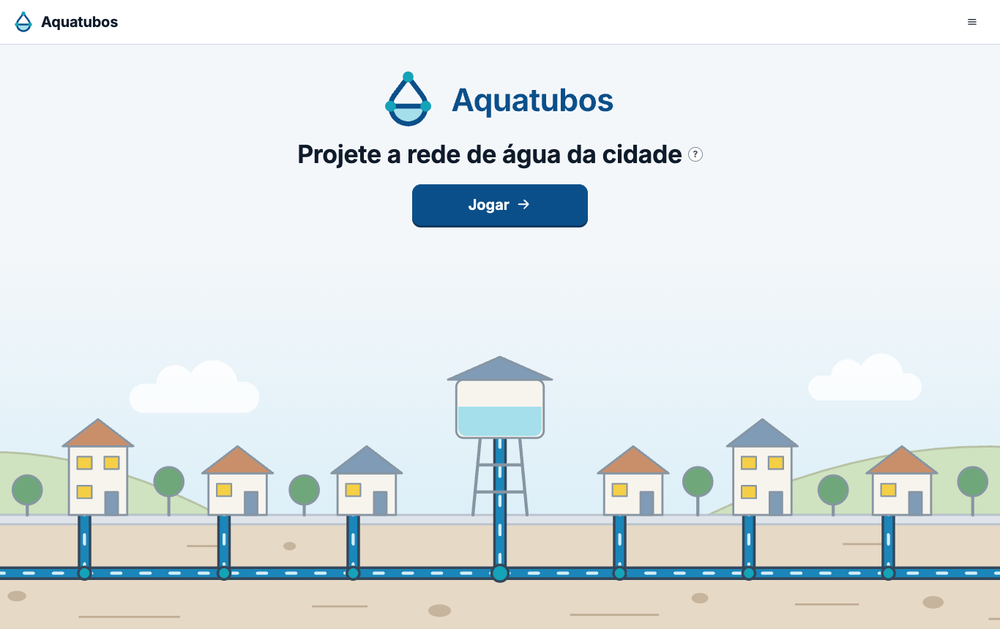 | 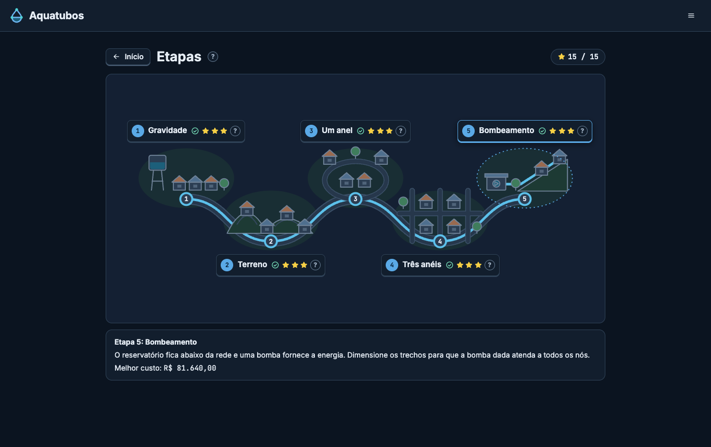 |

| Town view (stage 2, light)                           | Town view (dark)                                   |
| ---------------------------------------------------- | -------------------------------------------------- |
| 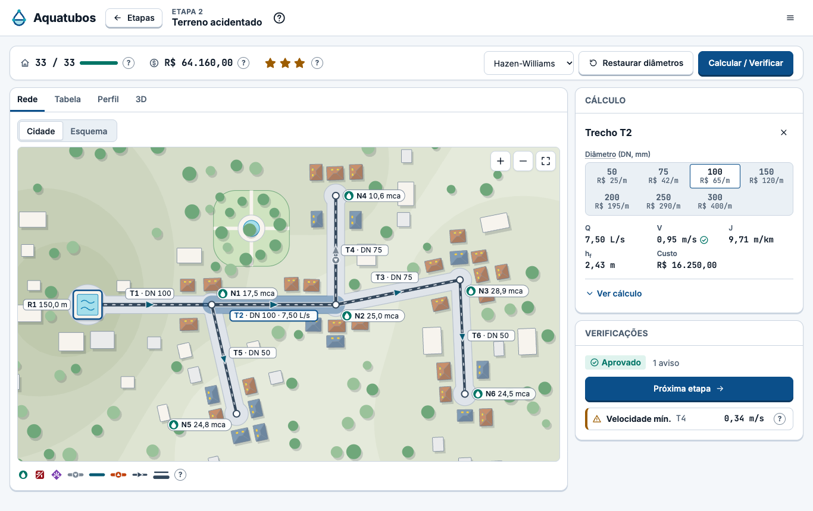 | 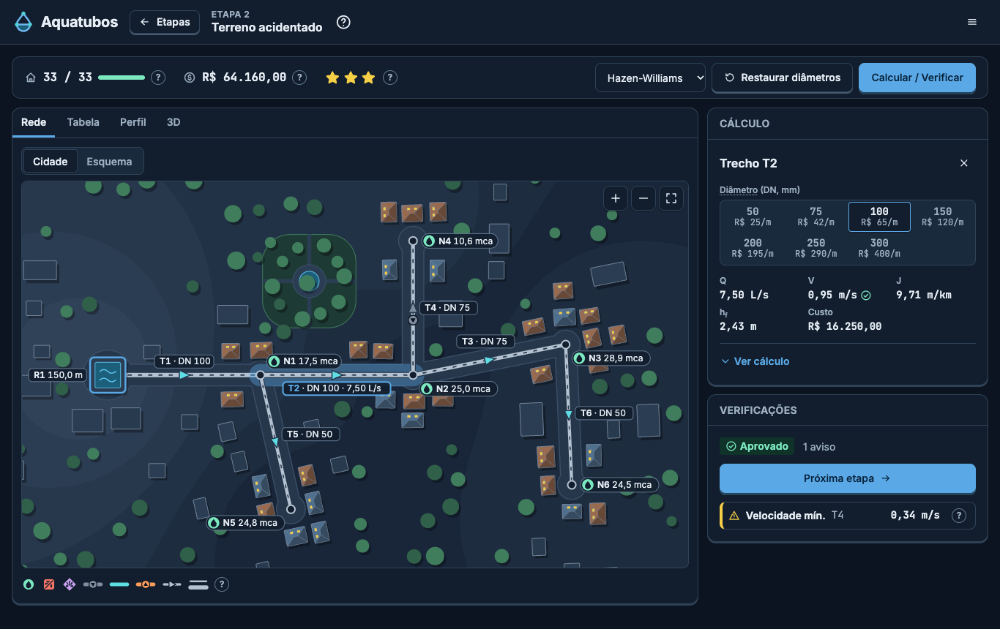 |

The same stage with the schematic toggle:

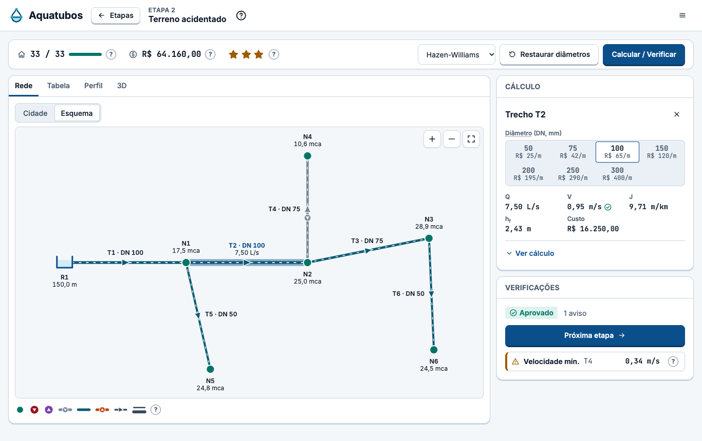

On a phone (Pixel 7 viewport): title screen, stage map, town view, bottom sheet half open with
the calculation, results table.

|                                                                   |                                                               |                                                          |                                                                  |                                                               |
| ----------------------------------------------------------------- | ------------------------------------------------------------- | -------------------------------------------------------- | ---------------------------------------------------------------- | ------------------------------------------------------------- |
| 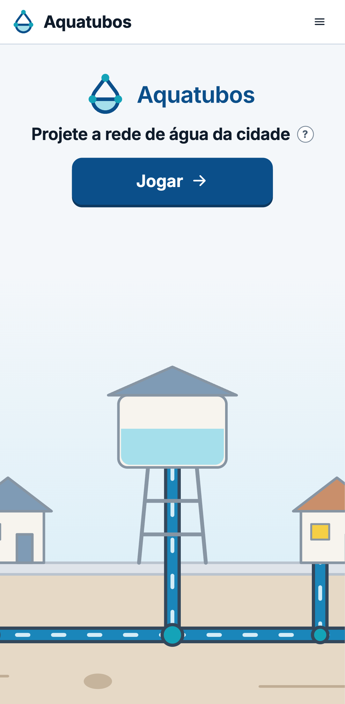 | 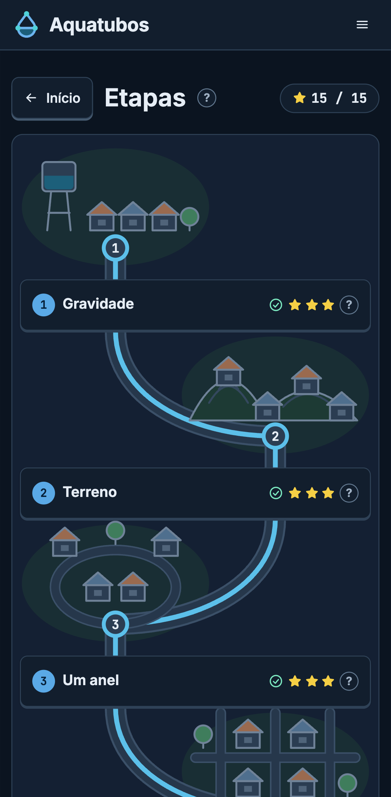 | 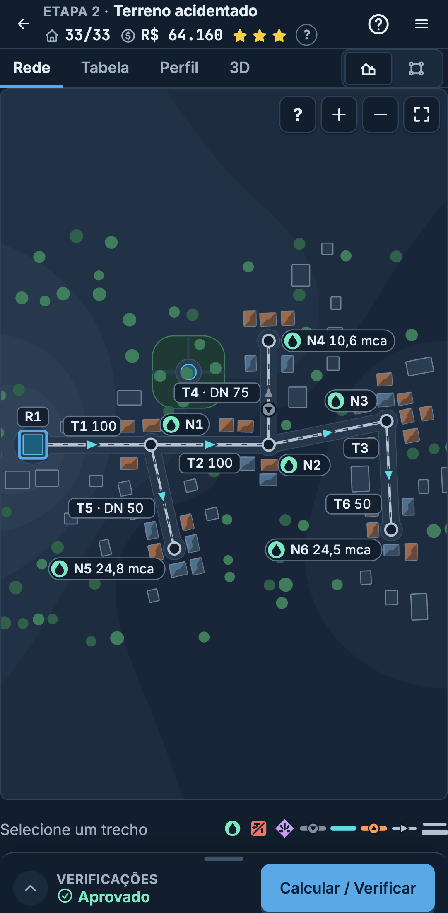 | 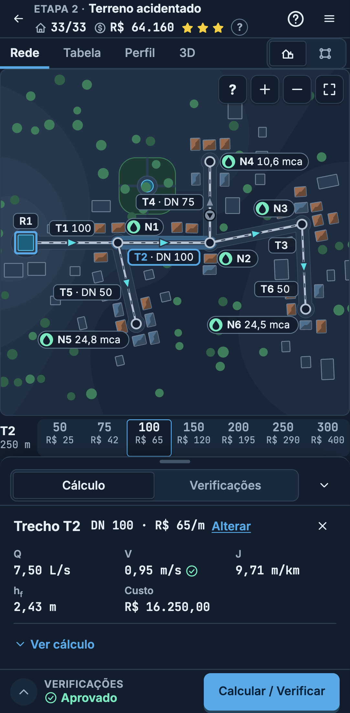 | 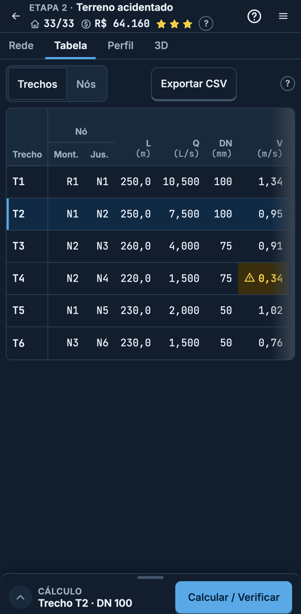 |

The three house states (served, dry taps, burst risk) with the legend help open:

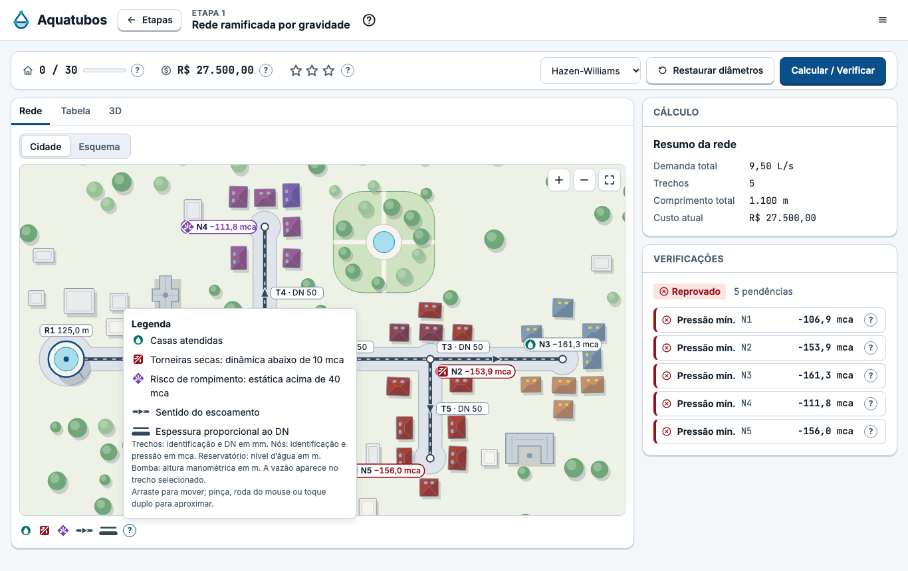

More: [title screen, dark](docs/screenshots/home-dark.png),
[title screen on a phone, dark](docs/screenshots/home-phone-dark.png),
[stage map, light](docs/screenshots/stage-map-light.png). Regenerate with `npm run screenshots`.

## The five stages

Each stage starts with diameters that fail at least one check. Stages unlock in order and are
independent of each other. Progress, best cost and stars are saved in the browser (IndexedDB).

| #   | Stage                                   | Network                                                            | What it introduces                                                                   |
| --- | --------------------------------------- | ------------------------------------------------------------------ | ------------------------------------------------------------------------------------ |
| 1   | Rede ramificada por gravidade           | Elevated tank, 5 nodes on flat ground, 5 pipes, 9.5 L/s            | Hazen-Williams, the calculation panel, minimum pressure of 10 mca                    |
| 2   | Terreno acidentado                      | Branched, 6 nodes between 111 m and 132 m, 6 pipes, 10.5 L/s       | Maximum static pressure, velocity limits, the HGL profile view                       |
| 3   | Rede malhada (um anel)                  | One loop, 4 nodes, 5 pipes, 10.5 L/s                               | Flow split in a loop, the Hardy Cross iteration table, flow direction                |
| 4   | Rede malhada com três anéis e orçamento | Three loops, 8 nodes, 11 pipes, 19 L/s, budget of R$ 159 000       | Cost of each diameter, budget, stars by cost relative to the cheapest passing design |
| 5   | Bombeamento                             | Reservoir below the network, one pump, 5 consumption nodes, 12 L/s | Pump curve, system curve, operating point, static pressure at shutoff head           |

Stars compare the cost of a passing design with the stage's reference solution, which is the
cheapest design that passes (found by exhaustive search or branch and bound): within 5 % gives
3 stars, within 25 % gives 2, otherwise 1.

## What is on screen

- **Title screen:** the logo, one button (Jogar / Continuar) and progress chips (stars, stages,
  best total cost). How to play, glossary, language, theme, install and about are in the header
  menu.
- **Stage map:** five neighbourhoods along a water main; locked stages are greyed, the next one
  is marked.
- **Town view (default):** an illustrated town generated from the stage geometry. Streets follow
  the pipes, each demand node is a cluster of houses, and after Calcular the houses show the
  result: lit windows and a water drop when served, a dry tap when the pressure is too low, a
  burst mark when the static pressure is too high (always an icon plus a colour). Pipes are
  coloured by velocity with flow-direction dashes. A toggle switches to the **schematic**, the
  plain engineering drawing of the same network.
- **HUD:** houses served, cost against the budget or the reference, stars, the objective.
- **Calculation panel:** for the selected pipe or node, the formula with the numbers substituted
  and the energy balance (hydraulic grade line − ground elevation = pressure). Click or tap a
  pipe to change its DN from the commercial list.
- **Checks:** each failed criterion with the value, the limit and what to change.
- **Results table:** the usual design spreadsheet (pipe, length, flow, DN, velocity, unit head
  loss, head loss, hydraulic grade line, ground elevation, pressure), exportable to CSV.
- **HGL profile**, **Hardy Cross table** (stages 3 and 4), **pump and system curves** (stage 5)
  and a **3D view** of terrain, pipes and the hydraulic grade surface, loaded on demand.
- A glossary of the technical terms, in both languages.

### On a phone or tablet

The stage screen becomes an app frame that does not scroll: the map fills the screen, the
calculation and the checks live in a bottom sheet (closed, half, full), the diameter keys sit in
one row under the map and Calcular / Verificar stays at the bottom within thumb reach. Tablets
get the same frame, with a side panel in landscape. Maps pan with one finger and zoom with a
pinch; pipes and houses have 44 px touch targets; tables keep their first column while scrolling
sideways; nothing depends on hover. Every screen has one header menu (how to play, glossary,
language, theme, install, about) and explanations sit behind small "?" buttons.

Tested with Playwright at 360, 390 and 430 px portrait, 844×390 landscape, 768×1024 and
1024×768, in light and dark, in Chromium device emulation, and the phone flow also in WebKit.

## Install

Aquatubos is a PWA: once installed it opens like an app and works without internet.

- **Computer (Chrome or Edge):** open the site, then Menu → "Instalar app", or the install icon
  at the right of the address bar.
- **Android (Chrome):** open the site, then Menu → "Instalar app", or the browser menu → "Instalar
  app" / "Adicionar à tela inicial".
- **iPhone or iPad:** open the site in Safari, tap Compartilhar (the square with an arrow), then
  "Adicionar à Tela de Início". Menu → "Instalar app" shows these steps.

The menu item appears only where the browser allows installing and disappears once the app is
installed. Firefox on a computer cannot install PWAs. When a new version is published the app
shows "Atualizar"; your progress is kept.

## Engineering basis

Internally everything is in SI units (m, m³/s, m/s); the interface shows L/s, mm and mca.

**Head loss.** Hazen-Williams, with C the Hazen-Williams coefficient (140 for PVC):

```
J = 10.643 · Q^1.852 / (C^1.852 · D^4.87)      hf = J · L
```

or Darcy-Weisbach with the Colebrook-White friction factor (Swamee-Jain as the first guess):

```
hf = f · (L/D) · V²/(2g)      1/√f = −2·log10( ε/(3.7·D) + 2.51/(Re·√f) )
```

**Network solution.** The Global Gradient Algorithm (Todini and Pilati, 1988), the method used by
EPANET, for junctions, fixed-head reservoirs, pipes and pumps, in branched and looped networks.
A pump is given by three points fitted to `H = a − b·Q^c`.

**Hardy Cross.** Shown as a per-iteration table for teaching, with signed head losses:
`ΔQ = −Σh / Σ(n·|h|/|Q|)`. Its final flows are tested to agree with the gradient solver.

**Demand.** `Q = P · q · K1 · K2 / 86400` with K1 = 1.2 and K2 = 1.5, and distribution per metre
of pipe to the nodes (helpers in `src/engine/demand.ts`; the stage files state node demands
directly).

**Checks**, labelled after ABNT NBR 12218:2017 and defined in one file
(`src/engine/config/nbr12218.ts`): minimum dynamic pressure 10 mca, maximum static pressure
40 mca, velocity between 0.6 and 3.5 m/s, minimum DN 50 mm.

**Cost.** Commercial diameters DN 50 to DN 300 with a price per metre
(`src/engine/data/pipeCatalog.json`). The prices are illustrative values in the style of SINAPI
compositions, not SINAPI data.

**Validation.** The solver is tested against EPANET (through
[epanet-js](https://github.com/modelcreate/epanet-js), a development dependency) on a branched
network, a two-loop network and a network with a pump, and the formulas against hand-computed
values. Details in [docs/ARCHITECTURE.md](docs/ARCHITECTURE.md#testing-strategy).

### Simplifications

- Internal diameter is taken equal to the nominal diameter.
- Steady state at the design flow; no tanks, valves, minor losses or extended-period simulation.
- Minimum velocity is reported as a warning, not a failure.
- The limits are the values commonly taught for NBR 12218; check the standard itself for real
  design work. This is a teaching tool, not design software.

## Run, test, build

Requires Node 22.12 or newer and npm.

```bash
npm ci
npm run dev        # http://localhost:5173/aquatubos/
```

```bash
npm run lint       # ESLint and Prettier check
npm run typecheck
npm test           # unit tests (Vitest)
npm run coverage   # fails under 80 % line coverage of src/engine
npm run build
npm run preview    # serves the production build at http://localhost:4173/aquatubos/
npm run e2e        # Playwright, desktop and phone projects; first run: npx playwright install chromium
```

## Deploy

Every push to `main` runs [`deploy.yml`](.github/workflows/deploy.yml), which builds the app and
publishes it to GitHub Pages. [`ci.yml`](.github/workflows/ci.yml) runs lint, typecheck, tests
with coverage, the build and the phone end-to-end tests on every pull request.

## Documentation

- [docs/ARCHITECTURE.md](docs/ARCHITECTURE.md): modules, data flow, the hydraulic engine, the
  scenario file format, testing and CI/CD.
- [AGENTS.md](AGENTS.md): commands, conventions and how to add a stage, a formula or a check.
- [docs/BRAND.md](docs/BRAND.md): logo, palette, typography and icon generation.

## Relation to the thesis

The original Aquatubos (Unity, 2021) was built for the author's undergraduate thesis
([source](https://github.com/jvsena42/aquaplay_tcc)). It followed NBR 12218/2017, used
Hazen-Williams on branched networks, and the player changed diameters until every consumption
point had at least 10 mca. The thesis listed as future work: a cost score for economical
diameters, carrying diameters across phases, and looped networks.

This version adds looped networks (stages 3 and 4), a cost score against a computed reference
(all stages) and a budget (stage 4), pumping (stage 5) and Darcy-Weisbach. The network is shown
as an illustrated town, with the schematic one toggle away. Diameters are not
carried across stages; each stage stands alone. It also corrects three errors of the original
code: Hardy Cross summing unsigned head losses, Hazen-Williams receiving an absolute roughness
instead of the coefficient C, and a head loss in metres compared against a limit in kPa.

## References

- ABNT NBR 12218:2017. Projeto de rede de distribuição de água para abastecimento público.
- Todini, E.; Pilati, S. (1988). A gradient algorithm for the analysis of pipe networks. In
  Computer Applications in Water Supply, vol. 1.
- Rossman, L. A. (2000). EPANET 2 Users Manual. U.S. Environmental Protection Agency.
- Cross, H. (1936). Analysis of flow in networks of conduits or conductors. University of
  Illinois Engineering Experiment Station, Bulletin 286.
- Porto, R. M. Hidráulica Básica. EESC-USP.

## Licence

[MIT](LICENSE)
