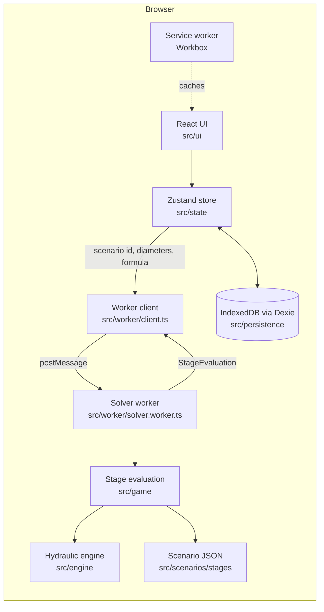
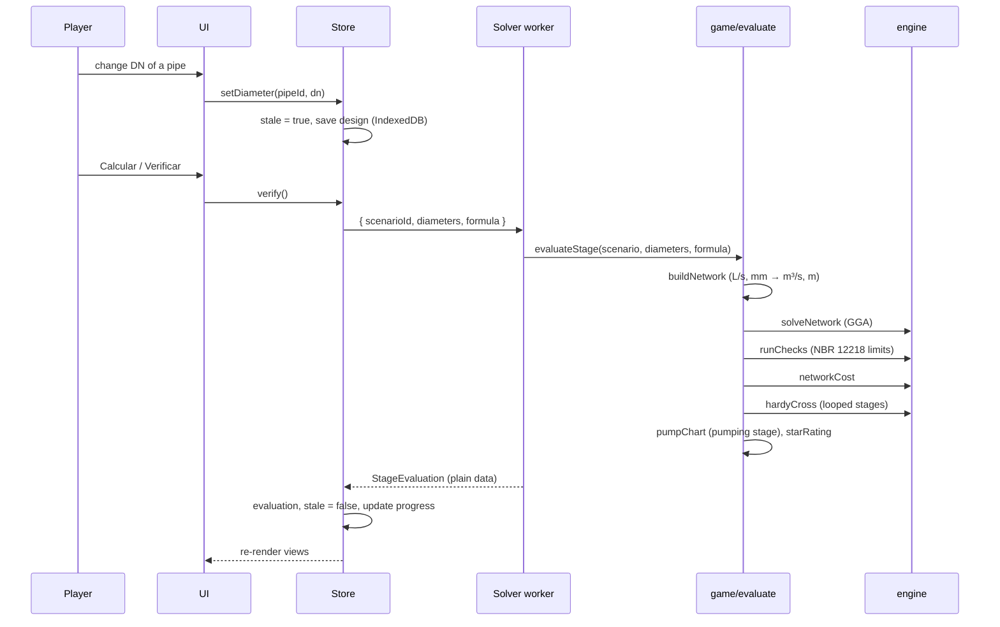
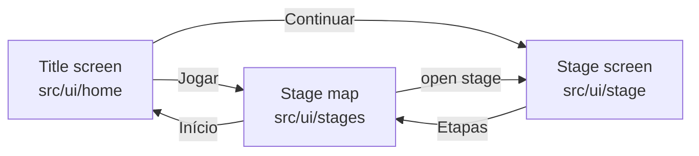

# Architecture

Aquatubos is a static single-page app. Everything runs in the browser: there is no backend.
It is built with Vite, React and TypeScript and deployed to GitHub Pages at
<https://jvsena42.github.io/aquatubos/>.

## System overview



## Module map

| Module      | Path                           | Responsibility                                                                                                                                                                                                                        | May import                           |
| ----------- | ------------------------------ | ------------------------------------------------------------------------------------------------------------------------------------------------------------------------------------------------------------------------------------- | ------------------------------------ |
| Engine      | `src/engine`                   | Head loss formulas, pump curve, GGA solver, Hardy Cross, demand helpers, checks, cost. Pure TypeScript, SI units, no DOM, no React.                                                                                                   | nothing outside `src/engine`         |
| Scenarios   | `src/scenarios`                | Stage files (JSON), their TypeScript type, loader and structural validator.                                                                                                                                                           | engine types                         |
| Game        | `src/game`                     | Scenario → SI network, stage evaluation (solve, check, cost, stars), system curve, reference solution search, table/CSV and profile data, house counts and service status, town generator (`game/town`).                              | engine, scenarios                    |
| Worker      | `src/worker`                   | Web Worker that runs `evaluateStage`, and the promise-based client. Falls back to the calling thread where `Worker` does not exist (unit tests).                                                                                      | game, scenarios                      |
| State       | `src/state/store.ts`           | One Zustand store: preferences, saved progress, the open stage, diameters, selection, last evaluation, `verify()`.                                                                                                                    | game, scenarios, worker, persistence |
| Persistence | `src/persistence/db.ts`        | Dexie database `aquatubos`: `progress` (per stage: completed, stars, best cost, last design) and `preferences` (language, theme).                                                                                                     | game types                           |
| UI          | `src/ui`                       | Title screen (`home`), stage map (`stages`), stage screen (`stage`), HUD (`hud`), town view (`town`), schematic (`network`), calculation and checks panels, results table, HGL profile, charts (`panels`, `charts`), glossary, shell. | everything except `three`            |
| 3D          | `src/ui/three`                 | react-three-fiber scene. Loaded with `React.lazy`, so three.js is a separate chunk fetched when the 3D tab opens.                                                                                                                     | three, @react-three/fiber            |
| i18n        | `src/i18n`                     | `useTr()` picks `pt` or `en` from `{ pt, en }` objects kept next to the components; `useFormat()` formats numbers per language.                                                                                                       | state                                |
| Styles      | `src/styles`                   | `tokens.css` (design tokens, light and dark) and `global.css` (base elements and shared classes). See [BRAND.md](BRAND.md).                                                                                                           |                                      |
| PWA         | `vite.config.ts`, `src/pwa.ts` | vite-plugin-pwa generates the manifest and a Workbox service worker that precaches the build, so the app works offline after the first visit.                                                                                         |                                      |

The dependency direction is one way: engine ← game ← worker/state ← UI. The engine never imports
from the rest of the app, which is what lets it run in a worker and in Node tests unchanged.

## Data flow



`StageEvaluation` (`src/game/types.ts`) is the single object every view reads: the SI network, the
solver result, the check report, cost, budget status, stars and, where the stage uses them, the
Hardy Cross table and the pump chart data. It is plain JSON-compatible data because it crosses the
worker boundary by structured clone.

Opening a stage also runs one evaluation so the network is drawn with pressures and velocities,
but only `verify()` records progress.

## Screens

The store field `screen` (`home` or `map`) and `scenario` (the open stage, or null) decide what
is shown:



The title screen and the stage map are in the main chunk. The stage screen (HUD, town view,
schematic, panels, charts) is a lazy chunk, and the 3D view is another one inside it.

The network tab of a stage has two drawings of the same scenario, chosen with the
Cidade | Esquema toggle (`networkView` in the store, saved in IndexedDB): the illustrated town
(`src/ui/town`, the default) and the engineering schematic (`src/ui/network`). Both use the same
selection in the store, the same `data-element` / `data-id` attributes and the same DN picker.

## Town view

### Houses and service status (`src/game/houses.ts`)

Each demand node is drawn as a cluster of houses. `houseCount(node)` is 3 houses per L/s of
demand, at least 2 and at most 12; a node without demand has none. `serviceStatuses` maps the
check report to what the houses show: `ok`, `low` (dynamic pressure below the minimum, dry taps),
`high` (static pressure above the maximum, burst risk) or `unknown` before a result. It follows
the report, so a check that is off in a stage never marks a house. `housesSummary` gives the
"Casas atendidas X / Y" of the HUD and the worst node, which the map pans to after a failed check.

### Generator (`src/game/town`)

`generateTown(scenario)` returns plain data in plan coordinates (metres), which the view only
draws. It is deterministic: a seeded PRNG, seeded by `scenario.town.seed` or the stage id, so the
same scenario always gives the same town and a new stage gets a town without extra work.

| Field             | Content                                                                                                 |
| ----------------- | ------------------------------------------------------------------------------------------------------- |
| `streets[]`       | One per pipe (the pipe runs under the street) and a narrower lane per pump link.                        |
| `plazas[]`        | A junction plaza at every node.                                                                         |
| `clusters[]`      | Per demand node: exactly `houseCount(node)` houses (position, size, rotation, roof variant) and a hull. |
| `buildings[]`     | Filler buildings, landmarks and extra houses, not tied to a node.                                       |
| `trees[]`, `park` | Trees and one park.                                                                                     |
| `reservoirs[]`    | Site and kind: `elevated` (water tower) or `ground`.                                                    |
| `pumps[]`         | Pump house at the middle of the pump link.                                                              |
| `terrain`         | Elevation bands for hill shading, or null when elevations span 4 m or less.                             |
| `bounds`, `focus` | Extent of everything, and the extent the view fits.                                                     |

Placement rules, covered by tests on the five stages and on random synthetic scenarios: no
house, building or tree overlaps a street, a plaza, a reservoir or pump site, the park interior
(trees may stand in the park) or another building; every demand node gets its exact number of
houses; filler scenery is capped at 250 items. `fillOrder(scenario)` orders pipes and nodes by
distance from the reservoirs and times the success sequence (water fills the pipes, then houses
light up).

### Overrides (`scenario.town`, all optional)

| Field                        | Meaning                                                                                     |
| ---------------------------- | ------------------------------------------------------------------------------------------- |
| `seed`                       | Seed of the generator. Default: the stage id.                                               |
| `park { x, y, radius? }`     | Park centre and radius (default 70 m). Default position: the largest free area.             |
| `landmarks [{ type, x, y }]` | `school`, `church`, `market` or `square` at a fixed position, turned to the nearest street. |
| `extraHouses [{ x, y }]`     | Extra scenery houses, not tied to a node.                                                   |
| `scenery: false`             | No filler buildings, trees or automatic park.                                               |

A reservoir can also set `kind` (`elevated` or `ground`); the default is elevated when the water
level is more than 8 m above the ground.

Fixed items are placed first and everything generated keeps clear of them. An override is not
checked against the streets, so place it in a free block.

### Rendering (`src/ui/town`)

Hand-written SVG. The static scenery (ground, terrain bands, park, streets, buildings, trees) is
one memoized layer that depends only on the scenario; pipes, house status, selection and labels
are separate layers, so a selection or a new result does not re-render the scenery. Labels are
placed by a collision-avoiding placer shared with the schematic (`src/ui/network/labels.ts`),
which drops lower-priority text first on small screens. The illustration style is described in
[BRAND.md](BRAND.md#illustration-style).

## Phone layout

Phones are a first-class target. The phone condition is `(max-width: 760px)`, or a short
landscape screen (`max-height: 500px`); it is evaluated in JavaScript (`useMediaQuery`) for layout
changes and repeated in the style sheets.

- **Stage screen** (`src/ui/stage`): an app frame of `100dvh` that does not scroll. From top to
  bottom: one-row header (logo, back, stage name, settings menu), a one-line HUD that expands on
  tap plus a "Mais ações" menu (briefing, formula, reset), a horizontally scrollable tab bar with
  the Cidade | Esquema switch, the view filling the rest, and a bottom sheet.
- **Bottom sheet** (`BottomSheet.tsx`, state in a pure reducer): detents `peek`, `half` and
  `full`. It holds the calculation panel and the checks, switched by a segmented control. The
  handle is a button (cycles the detents) and can be dragged; selecting a pipe or node raises the
  sheet to half; a failed check opens the checks; a pass leaves it closed with a notice so the
  map animation is visible. "Calcular / Verificar" sits in a bar at the bottom of the sheet and is
  never covered. In landscape the sheet becomes a panel on the right.
- **Maps** (`src/ui/network/usePanZoom.ts`, `gestures.ts`, `hit.ts`): pointer events with
  `touch-action: none`; one finger pans, two fingers pinch about their midpoint, a double tap
  zooms. A tap is resolved to the nearest drawn element within reach (`resolveHit`), with 44 px
  hit areas on coarse pointers. The town drops detail by zoom bucket (`town--detail-far|mid|near`).
  The legend collapses behind a button.
- **Tables**: sticky header and first column inside a horizontally scrolling frame with edge
  fades; on phones the results tab shows pipes or nodes, one table at a time.
- **Charts**: tick count and height follow the container; values are read by tapping (a readout
  area), not by hover.
- **3D**: touch orbit, pinch and pan; on small touch screens the pixel ratio is capped at 1.5 and
  the geometry uses the `low` quality budget.
- **Safe areas**: `viewport-fit=cover` and `env(safe-area-inset-*)` paddings on the header, the
  sheet and the main content; inputs are at least 16 px so iOS does not zoom.

The page never scrolls sideways; `e2e/mobile.spec.ts` asserts this on every screen.

## Hydraulic engine

### Units

Everything inside `src/engine` is SI: metres for length, diameter, elevation and head; m³/s for
flow; m/s for velocity. Scenario files and the UI use L/s, mm and mca. The conversion happens in
`game/buildNetwork.ts` on the way in and in the UI on the way out, using `engine/units.ts`.
Pressure is always a head in metres of water (mca), never kPa, so no threshold mixes units.

The internal diameter is taken equal to the nominal diameter. Real pipes differ by a few
millimetres; the simplification keeps hand checks simple.

### Head loss (`headloss.ts`)

Hazen-Williams, with `C` the Hazen-Williams coefficient (140 for PVC in the stages), never an
absolute roughness:

```
J = 10.643 · Q^1.852 / (C^1.852 · D^4.87)        [m/m]
hf = J · L
```

Darcy-Weisbach with the friction factor from Colebrook-White:

```
hf = f · (L / D) · V² / (2g)
1/√f = −2 · log10( ε/(3.7·D) + 2.51/(Re·√f) )
```

The Colebrook equation is iterated from the Swamee-Jain explicit value. Below Re = 2000 the flow
is laminar (`f = 64/Re`); between 2000 and 4000 `f` is interpolated so the function is continuous.

`pipeLoss(pipe, Q, options)` returns the signed head loss, its derivative with respect to `Q` and
the exponent `n` used by Hardy Cross (1.852 or 2). Near `Q = 0` the derivative is bounded below by
`MIN_HEAD_LOSS_GRADIENT` (1e-4 s/m²) so solvers can divide by it; EPANET does the same.

### Pump curve (`pump.ts`)

A pump is described by three points and fitted to `H = a − b·Q^c`. With the first point at
`Q = 0`, `a` is the shutoff head and `b`, `c` follow from the other two points in closed form.
Inside the solver the curve is continued as an odd function for reverse flow so the Newton
iteration stays stable. There is no check valve.

### Network solver (`solver.ts`)

The Global Gradient Algorithm of Todini and Pilati (1988), the method EPANET uses. Unknowns are
the flow in every link and the head at every junction. Each iteration solves

```
p_k = 1 / g_k                      g_k = dh_k/dQ at the current flow
y_k = Q_k − p_k · h_k              flow of the linearised link with no head difference

A · H = F                          one row per junction
A[i][i] = Σ p_k                    over links at junction i
A[i][j] = −p_k                     for a link between junctions i and j
F[i]    = −demand_i + Σ y_k (links arriving) − Σ y_k (links leaving) + Σ p_k · H_fixed

Q_k ← y_k + p_k · (H_from − H_to)
```

`h_k` is the head loss of link `k` (for a pump, minus the head it adds). `A` is
symmetric positive definite and is solved by dense Cholesky factorisation (`linalg.ts`); the
stages have fewer than 15 nodes. The same code handles branched and looped networks, several
reservoirs and pumps.

Convergence: `Σ|ΔQ| / Σ|Q| < 1e-9` (`DEFAULT_SOLVE_OPTIONS.flowTolerance`), at most 100
iterations. When the limit is reached the result has `converged: false` and the checks report it
as an error. Invalid input (unknown node ids, a junction with no path to a reservoir, non-positive
length or diameter, duplicate ids) throws.

### Hardy Cross (`hardyCross.ts`)

A teaching module: it produces the iteration table a student would write by hand. The stage
result always comes from the GGA solver.

- Loops come from the scenario file, or from `findLoops` (fundamental cycles of a BFS spanning
  tree) when the file does not list them.
- `initialLoopFlows` builds starting flows that satisfy continuity at every node.
- In each iteration, for each loop: head losses are computed with the sign of the flow in the loop
  direction, and `ΔQ = −Σh / Σ(n·|h|/|Q|)`. The sum of `h` is a signed sum. (Summing unsigned
  losses, as the original app did, never converges, and a test guards against it.)
- Corrections are simultaneous: every loop is evaluated with the flows of the previous iteration,
  then all corrections are applied. A pipe shared by two loops receives both, each with its sign.
- Stops when `max|ΔQ| < 1e-7 m³/s` or after 50 iterations.

Tests assert that the final Hardy Cross flows equal the GGA flows within 1e-6 m³/s on one-loop
and two-loop networks and on stages 3 and 4.

### Demand (`demand.ts`)

`designFlow` = population × per-capita consumption × K1 × K2 / 86400, with K1 = 1.2 and K2 = 1.5
by default. `distributeDemandByLength` spreads a total flow over nodes in proportion to pipe
length (half of each pipe's share to each end).

### Checks (`checks.ts`, `config/nbr12218.ts`)

The limits live only in `config/nbr12218.ts`, labelled ABNT NBR 12218:2017:

| Check                    | Limit   |
| ------------------------ | ------- |
| Minimum dynamic pressure | 10 mca  |
| Maximum static pressure  | 40 mca  |
| Minimum velocity         | 0.6 m/s |
| Maximum velocity         | 3.5 m/s |
| Minimum nominal diameter | 50 mm   |

Each scenario sets every check to `error`, `warning` or `off`. `runChecks` returns one issue per
violation with the element, the computed value, the limit and an explanation in Portuguese and
English. A design passes when it has no `error` issue. Minimum velocity is a warning in the
stages, because dead-end pipes with small demands cannot reach 0.6 m/s at DN 50.

Static pressure is the no-flow condition: the highest reservoir level reachable from the node,
plus the shutoff head of a pump on the way, minus the ground elevation. A pump discharge node
without demand is not a consumption point and is left out of the pressure checks.

### Cost (`cost.ts`, `data/pipeCatalog.json`)

A catalog of DN 50, 75, 100, 150, 200, 250 and 300 mm with a price per metre. The prices are
illustrative values in the style of SINAPI compositions. They are not SINAPI data.

## Scenario files

One JSON file per stage in `src/scenarios/stages`, typed by `src/scenarios/types.ts` and checked by
`validateScenario`. Display units are used because the files are meant to be edited by people.

| Field                                        | Meaning                                                                                 |
| -------------------------------------------- | --------------------------------------------------------------------------------------- |
| `id`, `order`                                | Stage id and position. Stage n unlocks when stage n − 1 is completed.                   |
| `title`, `summary`, `briefing`, `objectives` | Text as `{ "pt": …, "en": … }`.                                                         |
| `formula`                                    | Default head loss formula: `hazen-williams` or `darcy-weisbach`.                        |
| `hazenWilliamsC`, `roughnessMm`              | Pipe coefficient C and absolute roughness ε (mm) for all pipes.                         |
| `nodes[]`                                    | `id`, `x`, `y` (plan, m), `elevation` (m), `demandLps` (L/s).                           |
| `reservoirs[]`                               | `id`, `x`, `y`, `elevation` (ground, m), `waterLevel` (total head, m), optional `kind`. |
| `pipes[]`                                    | `id`, `from`, `to`, `length` (m), `initialDN` (mm), optional `fixed`.                   |
| `pumps[]`                                    | `id`, `from`, `to`, `points`: three `{ flowLps, head }` points.                         |
| `checks`                                     | `error`, `warning` or `off` for each check.                                             |
| `budget`                                     | Maximum cost in R$, or `null`.                                                          |
| `features`                                   | Which views the stage shows: `hglProfile`, `hardyCross`, `cost`, `pumpChart`.           |
| `loops[]`                                    | Optional loops for Hardy Cross: pipes with direction `1` or `-1` relative to the loop.  |
| `profilePath`                                | Node ids from the source to the critical node, the default HGL profile.                 |
| `reference`                                  | `diameters` (DN by pipe id), `cost` and `method` of the reference solution.             |
| `town`                                       | Optional overrides for the generated town scenery. See [Town view](#town-view).         |

### Stages and reference solutions

Stages are independent: diameters are not carried from one to the next. Progress (completed,
stars, best cost, last design) is stored per stage in IndexedDB.

The reference solution of a stage is the cheapest design that passes its checks. It is computed
by `findReferenceDesign` (`src/game/referenceSearch.ts`):

1. Up to 150 000 combinations: plain exhaustive search over the seven commercial diameters.
2. Otherwise: a heuristic (repeatedly shrink the pipe that saves the most while the design still passes, then pair moves) gives
   an upper bound, then branch and bound over the whole catalog prunes by cost only. Because no
   hydraulic monotonicity is assumed, the result is the cheapest passing design. Stage 4 (11 pipes)
   needs about 290 000 solves, a few seconds.

`npm run reference` prints the result for every stage; `WRITE=1 npm run reference` writes
`reference` (and, for stages with a budget, `budget` = 1.15 × reference cost rounded up to
R$ 1000) into the scenario files. Stars compare the player's cost with the reference: within 5 %
gives 3 stars, within 25 % gives 2, otherwise 1.

## Testing strategy

- **Engine unit tests** with hand-computed values written out in comments: head loss formulas,
  pump fit, single pipe and branched networks, continuity and loop closure on looped networks.
- **Cross-checks against EPANET** (`src/engine/epanet.test.ts`, using `epanet-js`, MIT): a
  branched network, a two-loop network and a network with a pump are solved in both engines.
  EPANET's Hazen-Williams formula in SI is `10.667·L·Q^1.852/(C^1.852·D^4.871)`, slightly
  different from the 10.643 / 4.87 form used here, so EPANET is given an equivalent coefficient
  per pipe; heads and flows then agree to 1e-9 m and 1e-9 L/s. With the same C in both, heads
  differ by 0.01 to 0.03 m, which a second test bounds. For Darcy-Weisbach, EPANET uses
  Swamee-Jain rather than Colebrook, and the difference is bounded at 0.05 m.
- **Hardy Cross against GGA** on looped networks and stages 3 and 4.
- **Stage tests** (`src/scenarios/stages.test.ts`): every stage is structurally valid, fails at
  least one check with its initial diameters, passes all checks with its reference solution, and
  stores the right reference cost.
- **Store, persistence and UI tests** with Testing Library and fake-indexeddb.
- **End-to-end** (`e2e/`, Playwright) against the production build. The desktop project
  (`stages.spec.ts`) plays the five stages from the title screen in the town view; it runs
  locally. The phone projects (`mobile.spec.ts`, Pixel 7 and iPhone 14 viewports with touch, in
  Chromium) play stage 1 by touch through the bottom sheet and assert that no screen overflows
  sideways; they also run in CI.

Coverage is measured for `src/engine` and `src/game`; the build fails under 80 % of lines in
`src/engine`.

## CI/CD

- `.github/workflows/ci.yml`, on every push to `main` and every pull request: `npm ci`, lint
  (ESLint and Prettier), typecheck, unit tests with coverage, build. A second job installs
  Chromium and runs the phone end-to-end projects.
- `.github/workflows/deploy.yml`, on push to `main`: build, upload `dist` with
  `actions/upload-pages-artifact`, deploy with `actions/deploy-pages`. GitHub Pages is configured
  with source "GitHub Actions". Vite `base` is `/aquatubos/`, matching the repository name.

## Key decisions

| Decision                                                  | Reason                                                                                                                                         |
| --------------------------------------------------------- | ---------------------------------------------------------------------------------------------------------------------------------------------- |
| GGA as the solver, Hardy Cross only as a table            | GGA handles branched, looped and pumped networks with one code path and converges quadratically. Hardy Cross is what students compute by hand. |
| Own solver instead of shipping EPANET (WASM)              | The calculation must be readable and each step shown with numbers. EPANET stays as a test oracle.                                              |
| SI inside the engine, display units at the edges          | The original app compared metres with kPa. One unit system inside removes that class of error.                                                 |
| Internal diameter = nominal diameter                      | Hand checks use the DN. Documented as a simplification.                                                                                        |
| Explanations for failed checks are produced by the engine | The text needs the numbers and limits the engine already has, and the engine stays the single source for both languages.                       |
| Minimum velocity as a warning                             | With a 50 mm minimum diameter, small dead-end demands cannot reach 0.6 m/s. Making it an error would make stages unsolvable.                   |
| Solver in a Web Worker                                    | Keeps the UI responsive and forces the evaluation result to be plain data.                                                                     |
| Strings as `{ pt, en }` objects next to components        | Two languages only; no key catalog to keep in sync.                                                                                            |
| Hand-written SVG for the network and charts               | Small bundle, full control of labels and accessibility. three.js is only for the optional 3D view and is lazy-loaded.                          |
| Stages independent of each other                          | A stage can be replayed or opened directly without depending on an earlier design.                                                             |
| Reference by exhaustive search or branch and bound        | Star ratings compare against a proven cheapest design, not a guess.                                                                            |
